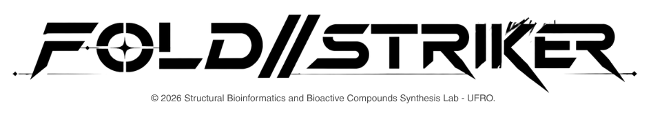

# FOLD//STRIKE — Molecular Arcade



FOLD//STRIKE es una adaptación local de Protein Fighter con combate y presentación de inspiración arcade,
conservando proteínas personalizadas, daño molecular y acceso remoto. Los tiempos
se diseñaron para estos personajes; no son los datos originales de SF III.

Última revisión: **v12.1** — vídeo por inactividad, interfaz estable, enlaces RAVEN y paquete portátil.
Consulta [cómo conservar y publicar esta edición](docs/DISTRIBUCION.md).

[RAVEN | プログラム](https://raven-karasu.github.io/page/) · [SB²CS UFRO](https://sbbcs-ufro.github.io/page/) · [Feedback](https://foldstrike.framer.website/).

## Jugar

En Windows, abre **FOLD-STRIKE.exe**: inicia el servidor local y la ventana del juego sin Python. Mantén el ejecutable junto a los archivos de esta carpeta. Su icono en la bandeja permite abrir el contador de rendimiento y cerrar el servidor. Consulta [desktop/LEEME.md](desktop/LEEME.md).

También puedes ejecutar `JUGAR.bat` y abrir http://127.0.0.1:8000.
También se puede servir esta carpeta con Python:

```powershell
python serve.py --port 8000 --bind 0.0.0.0
```

Se necesita un navegador con WebGL2. No hay compilación ni dependencias npm.
La portada ofrece **ARCADE, CAMPAÑA, AJUSTES y CRÉDITOS**, más un acceso a
[Feedback](https://foldstrike.framer.website/). Dentro de ARCADE se elige
**VS CPU, VERSUS, REMOTO, TRAINING, TUTORIAL o TORNEO**. El botón CONTROLS abre la guía y pausa la pelea local. MENÚ vuelve a la
portada y cierra la conexión si se estaba jugando remotamente.

## Selección y recorrido arcade

La presentación comienza con la identidad de **SB²CS UFRO** y un enlace al
[laboratorio](https://sbbcs-ufro.github.io/page/). Después de elegir el modo:

1. Elige entre **20 proteínas distintas**, con estructuras y retratos incluidos
   localmente. También está la casilla **CUSTOM PDB**, que permite buscar por ID
   PDB/UniProt o importar un archivo PDB/mmCIF.
2. La primera Super Art es **exclusiva de la proteína elegida** y aparece por
   defecto. Fold Breaker y Helix Tempest quedan como alternativas compartidas.
   Las estructuras importadas mantienen sus tres opciones de forma.
3. Elige el rival y su Super Art. En VERSUS, esta selección corresponde a P2.
   La tarjeta **?** sortea proteína y Super Art en un solo paso, tanto para el
   jugador como para el rival. Aparece dentro del plantel de Arcade, Versus,
   Remote y Training; el importador continúa disponible.
   En REMOTE se eligen ambos personajes en la computadora. Después, cada teléfono escanea el QR de su jugador y muestra únicamente un mando virtual.
4. La pantalla VS espera a que los modelos estén listos y presenta el combate.
5. Por defecto se juega al mejor de tres: **las siguientes rondas empiezan automáticamente**,
   conservan el marcador y restauran la vida. No se necesita REFOLD. Los ajustes
   permiten cambiar rondas y tiempo fuera de campaña; se fijan al comenzar cada combate.
6. Al terminar aparece el ganador. **ESTADÍSTICAS** abre voluntariamente los
   resultados reales de ambos jugadores; **VOLVER** regresa al vencedor. **CONTINUAR**
   y el avance automático omiten esa tabla. En campaña pasan al diálogo posterior;
   una victoria de Arcade permite elegir otro rival. Una derrota o un combate
   Versus ofrece revancha durante diez segundos.

Las selecciones tienen un temporizador de 30 segundos y los Super Arts de 20;
puedes confirmar antes con Enter, A del mando o el botón en pantalla. Abrir la
guía o ajustes detiene ese temporizador. El marcador y el grado se calculan a
partir de golpes, daño, defensas y técnicas registrados en el combate; no usan
las fórmulas de puntuación de SF3.

Plantel: Ubiquitin, GFP, Myoglobin, Hemoglobin, Lysozyme, BPTI, RNase A, TIM,
Carbonic II, Adenylate, Cytochrome, Protein G, Pin1, Engrailed, Trypsin, SOD,
Streptavidin, Top7, CI2 y Barstar. Ver [procedencia y adaptación](assets/roster/README.md).

Cada ficha incluye función, aplicaciones de investigación, cadena utilizada,
DOI del depósito PDB y DOI del artículo cuando está disponible. Se abre con
**FUNCIÓN, APLICACIONES Y FUENTES** o **X** del mando. La entrada histórica 1SOD
está identificada como obsoleta y sustituida por 2SOD en el archivo PDB.

## Campaña

Cinco capítulos seleccionables, con tres jefes y un jefe final por capítulo:

| Capítulo | Anticuerpo seleccionable | Encuentro final |
| --- | --- | --- |
| Señales de crecimiento | Trastuzumab / pertuzumab | HER2 |
| La cascada inflamatoria | Adalimumab / infliximab | TNF |
| Puntos de control | Pembrolizumab | PD-1 |
| La red vascular | Ranibizumab | VEGF-A |
| El umbral alérgico | Omalizumab | IgE |

Elige capítulo, anticuerpo y Super Art. El mapa muestra el siguiente encuentro;
ganar avanza un jefe y perder permite reintentarlo. El progreso y los capítulos
completados se guardan en este navegador y se recuperan con **REANUDAR CAMPAÑA**.
Se incluyen 27 modelos adicionales preparados localmente, con estructuras reales
y retratos propios. Ver [fuentes y alcance científico](assets/campaign/README.md).

Cada capítulo comienza con una escena de contexto. Los 20 encuentros tienen
diálogos propios antes del combate y tras ganar, con retratos en los laterales
y énfasis visual en quien habla. **A / Enter** completa el texto y otra pulsación
avanza; **B / Esc** vuelve a la línea anterior cuando no hay respuestas abiertas.
En una decisión, **A / B / X / Y** corresponden a sus cuatro respuestas; Esc permite volver. **SALTAR ESCENA** continúa la ruta
sin saltarse el combate. La preferencia del sistema de movimiento reducido muestra
el texto directamente y desactiva las animaciones decorativas.

Al completar los cinco capítulos se muestran créditos continuos, comenzando por
el logo del juego y terminando con Felipe Lizama. Incluyen los logos proporcionados
de RAVEN, Solab y MIT. Se desplazan a 35 px/s; **A / Espacio** permite pausar o
reanudar, y las flechas, rueda o gesto táctil permiten recorrerlos manualmente.
Con movimiento reducido comienzan pausados. También se abren desde la portada
e incluyen un listado consultable de depósitos, publicaciones y DOI.

Los combates son ficción educativa: solo el jefe final representa la diana directa
del anticuerpo elegido. Los encuentros anteriores exploran proteínas relacionadas;
no representan que el anticuerpo reconozca todas ellas. Las adaptaciones jugables
usan cadenas y fragmentos de los depósitos, no necesariamente moléculas completas.

## Controles

| Acción | P1 | P2 en VERSUS |
| --- | --- | --- |
| Movimiento | W A S D | Flechas |
| Puños ligero / medio / fuerte | U I O | 1 2 3 |
| Patadas ligera / media / fuerte | J K L | 4 5 6 |
| Especial directo | Q | 7 |
| Super Art directo | E | 8 |
| Pausa | Esc | Esc |

Conecta un mando Xbox por USB o Bluetooth y pulsa un botón con la página activa.
Se usa la Gamepad API con mapeo `standard` (también pueden funcionar otros mandos
que el navegador exponga con ese mapeo). El primer mando corresponde a P1 y el
segundo a P2; en la página del invitado, el primer mando controla P2.

| Acción | Mando Xbox |
| --- | --- |
| Moverse | Cruceta o stick izquierdo |
| Puños ligero / medio / fuerte | X / Y / RB |
| Patadas ligera / media / fuerte | A / B / RT |
| Especial / Super Art elegido | LB / LT |
| Mantener bloqueo | LT + RT juntos |
| Pausa / reanudar | Menu |
| Confirmar / volver en menús | A / B |
| Abrir ficha de la proteína seleccionada | X |

La cruceta o stick desplaza el foco entre tarjetas y botones de pantalla. **A**
activa el elemento enfocado, incluidos **REGRESAR**, **CONTINUAR** y ajustes;
**B** vuelve o cierra el diálogo. Cualquiera de los mandos puede recorrer los menús.

Los ataques se activan al pulsar, sin repetición por mantener el botón. El stick
tiene zona muerta y soltar o desconectar el mando libera las direcciones. En PC
los botones táctiles pueden mostrarse con TECLAS; en pantallas táctiles aparecen
automáticamente. Para mandos, usa HTTPS o `localhost`; una IP LAN por HTTP puede
no disponer de esta API en el navegador.

F / G / H mantienen los accesos anteriores de puño medio, patada media y guardia.
En móvil, los botones LP / MP / HP y LK / MK / HK sustituyen esas teclas.

- **Dash:** pulsar dos veces hacia delante o atrás, soltando entre pulsaciones.
- **Guardia:** mantener **B**, coma para P2 o **LT + RT** en el mando; también hay un
  botón GUARD táctil. Consume 22 puntos de energía por segundo y 12 + 45 % del
  daño nominal de cada golpe bloqueado. Sin energía no bloquea; agotarla impone
  0,9 s de espera. Abajo + bloqueo cubre ataques bajos; los ataques aéreos requieren
  guardia de pie. Retroceder solo mueve al luchador. Los especiales pueden
  producir daño residual al bloquear.
- **Parry:** pulsar delante justo antes de un golpe alto; abajo antes de uno bajo.
  También existe parry aéreo con delante. Mantener una dirección no lo repite;
  fallar deja una breve espera antes de volver a intentarlo.
- **Especial:** cuarto de círculo hacia delante + ataque, o el botón directo.
  Se interpreta respecto al lado hacia el que mira la proteína.
- **Super Art:** doble cuarto de círculo + ataque, o el botón directo. Consume una
  de las tres cargas disponibles. Con las tres completas, **E / LT** ejecuta
  automáticamente el clímax exclusivo y consume las tres. Golpear, bloquear y hacer parry acumula energía.
- **Combos:** los normales pueden encadenarse de ligero a medio y fuerte cuando
  impactan. Un normal conectado, incluso bloqueado, puede cancelarse en especial;
  un especial conectado puede cancelarse en Super Art. Un ataque fallado no permite
  esas cancelaciones. El daño se reduce progresivamente en cadenas largas.
- **Entrenamiento:** tiempo detenido, rival quieto, energía de super ilimitada.
  R reinicia ambos personajes, incluso después de un KO.

Cada una de las 20 proteínas del plantel y los 27 actores de campaña tiene un
especial propio en `signature-moves.js`: nombre, tiempos, daño y trayectoria. Los
47 perfiles tienen objetivos articulados distintos y se organizan en siete familias mecánicas: rodada, giro erguido, onda,
embestida, salto, golpe ascendente y retroceso. No son 47 animaciones independientes.
**Q / LB** activa ese especial; su descripción aparece en la selección. Las
estructuras importadas conservan el especial asignado según su forma. El Super Art
se elige por separado y **E / LT** activa esa elección con menos de tres cargas.
La primera opción ahora pertenece al personaje, en lugar de compartir Fold. Fold Breaker gira acostado
y avanza; Helix Tempest gira erguido con los brazos extendidos y varios impactos.
Las clases BALANCED, SPEED, POWER y TECHNICAL añaden ajustes moderados de movilidad
y daño; son decisiones de diseño del videojuego, no propiedades biológicas.

## Cambios de combate

`arcade.js` contiene las reglas y los datos de los movimientos a 60 Hz. Se distinguen
preparación, actividad y recuperación. Las colisiones empiezan en el primer cuadro
activo, y las animaciones incluyen anticipación, extensión, contacto y regreso.
Los golpes fuertes de pie usan poses de recto y patada circular.

Los saltos tienen una trayectoria comprometida: soltar arriba no los acorta.
El daño sigue desplegando la proteína y modifica fuerza, alcance y movilidad,
pero ya no estira el tiempo de los ataques. La movilidad conserva al menos el 80 %
para que el control no se vuelva excesivamente lento al final de una ronda.

La importación PDB/mmCIF/AlphaFold, las representaciones moleculares y los mapas
siguen en el juego. Los contactos de combate continúan dependiendo de la geometría
molecular: todavía requieren ajuste de equilibrio entre estructuras muy distintas.

## Música y efectos

Se incluyen 24 grabaciones: las 15 de `../sounds/background` y las nueve nuevas
proporcionadas en la carpeta de trabajo, además de siete efectos de `../sounds/sfx`. `scripts/prepare_presentation.py` los copia al directorio
servido y genera `assets/audio/manifest.json`. Conserva los archivos originales;
`spining.mp3` corresponde al efecto de giro. El inicio de ronda sigue usando el
efecto sintetizado, como se solicitó al no necesitar `start.mp3`.

| Sección | Música |
| --- | --- |
| Logo del juego y portada (los logos institucionales son silenciosos) | Slash Snake |
| Selección Arcade / Versus / Remote / Training | Mitsui's Pride |
| Capítulos y elección de anticuerpo | Longing for AIR |
| Diálogo previo al primer jefe | Confession |
| Victoria y diálogo posterior al primero | Resolution (Slow) |
| Diálogos previos a jefes 2–3 | The theme of Mikio Shirato |
| Victoria y diálogos posteriores a jefes 2–3 | The theme of Mikio Shirato (Slow) |
| Diálogo previo al jefe final | Alert of oz |
| Victoria y diálogo posterior al final | BLIZZARD GUNNER |
| Créditos | Chill — Holder & GameChops |

Los combates barajan **14 canciones**: Powerful Confrontation, Violently… In Vain,
Rukawa Kaede, Avalanche, Go Ahead, Run up, You Blow My Mind (Dudley), Theme of Q,
Karma (Electric Fountain), Spirit of the Night (Instrumental), CRASH BOOM BURN ME UP,
WONDERFUL LOVE (Instrumental), My Curse (Instrumental) y Reject Yourself (Instrumental).
En los jefes finales de campaña, **Alert of oz** permanece en bucle, sin cambiar
de canción y sin reiniciarse al pasar del diálogo previo al combate.
En AJUSTES → MÚSICA puedes elegir aleatorio o una canción fija por separado para
VS CPU, VERSUS, REMOTO y TRAINING/TUTORIAL. Una elección fija se reproduce en bucle.

En reproducción aleatoria, al acercarse el final de una grabación comienza la siguiente mediante un fundido de
700 ms. La bolsa aleatoria evita repeticiones hasta agotarse y evita repetir la última
al barajar de nuevo. La música continúa entre rondas. Si falla un archivo, se intenta
otro disponible. El banner muestra brevemente el título y el intérprete conocido;
los efectos no muestran banner. Los archivos se conservan sin modificar, incluido
cualquier silencio que contenga la grabación original.

AJUSTES ofrece silencio general y volúmenes separados para música y efectos. La música comienza al 20 % y los efectos al 45 %; los ajustes antiguos se reducen una vez. El banner desaparece a los 4,5 segundos. La navegación usa un efecto breve. La confirmación reproduce `select.mp3` completo, después del silencio inicial: navegar o cambiar de escena no lo corta. Las pulsaciones repetidas durante su reproducción no acumulan sonidos. Se omiten los 250–280 ms iniciales de silencio de las grabaciones de interfaz para que respondan al pulsar. Música y efectos tienen directorios separados para evitar colisiones de nombres.
La música se solicita al llegar al logo del juego; los logos institucionales son
silenciosos y solo muestran sus marcas, sin descripciones. El ejecutable utiliza
un perfil propio de Edge con reproducción automática para iniciar la música sin
una pulsación previa. Si el navegador bloquea la reproducción automática, el siguiente clic
o tecla normal habilita el audio, sin un botón adicional de activación. Un mando
por sí solo puede no habilitarlo. La reproducción se detiene al ocultar la pestaña.

## Fluidez y conexión

El modo **FLUIDO**, predeterminado en AJUSTES → ANIMACIÓN, dibuja cintas simplificadas
mediante una malla WebGL de topología fija. Conserva las coordenadas de todos los
residuos, las rupturas de cadena, las paletas y la simulación molecular. Su
apariencia difiere del cartoon científico: **DETALLADO** permite recuperar ese
visor. El importador y las fichas siguen usando el visor original.

La simulación usa pasos de 60 Hz y el dibujo tiene un objetivo fijo de 60 por
defecto: ya no cambia automáticamente a 30. `?fps` muestra los valores medidos;
`?fps&render=30` fija 30 y `?fps&render=auto` habilita el modo adaptativo anterior.
El objetivo no garantiza 60 FPS en cualquier dispositivo o estructura importada.
El análisis molecular se ejecuta en un Web Worker con una frecuencia independiente,
sin calcular mapas ocultos. La densidad del lienzo se limita a 1,25 y ambos
personajes se cargan antes de reconstruir el visor una sola vez. Si el navegador
no permite Workers, se conserva el cálculo local como alternativa.

REMOTE muestra la pelea en la computadora y únicamente el mando virtual en cada
teléfono. Admite dos teléfonos, o uno combinado con teclado/mando local. Elige las
proteínas en el PC y luego la conexión:

- **INTERNET** (predeterminado en el ejecutable): prepara un enlace
  HTTPS temporal con Cloudflare Tunnel. El PC debe tener Internet; el teléfono puede
  usar datos móviles u otra red. Espera a que aparezca el QR, escanéalo y pulsa
  INICIAR COMBATE cuando figure CONECTADO. No requiere cuenta, dominio ni abrir
  puertos del router. Preparar y comprobar el enlace puede tardar hasta dos minutos.
- **MISMA RED LOCAL**: ambos dispositivos comparten Wi-Fi o punto de acceso, sin
  aislamiento entre clientes. Funciona sin Internet. Elige el adaptador correcto;
  si Windows lo solicita, permite el juego en redes privadas. `JUGAR.bat`/Python
  ofrece esta modalidad; el conector de Internet pertenece al ejecutable Windows.

La superficie del mando permanece fija. Se cancelan los gestos de pellizco y doble
toque, además del desplazamiento, sin impedir las pulsaciones simultáneas.
Las diagonales y pulsaciones simultáneas permiten moverse y atacar. La pérdida de
señal suelta los controles y pausa la pelea; reconecta y pulsa PAUSA. Cada QR lleva
un token distinto por jugador. Volver al inicio cierra la sala y el enlace público.
No compartas un QR con quien no quieras invitar a controlar ese jugador.

El servidor público solo entrega los tres archivos del mando, su icono y la API de
entradas. La administración y los archivos del juego se mantienen accesibles desde
el PC. El puente tiene un listener independiente, aunque el conector se ejecute en
la misma máquina. No se publican los modelos, música ni partidas. Las pulsaciones
se agrupan con números de secuencia para conservar toques breves y descartar paquetes
antiguos. La cola es acotada; una conexión excesivamente lenta suelta los controles.

El conector oficial y su licencia se incluyen en `desktop/tools/`. Debes conservar
la carpeta completa al trasladar el juego. [Quick Tunnels de Cloudflare](https://developers.cloudflare.com/tunnel/get-started/quick-tunnels/)
es un servicio temporal sin garantía de disponibilidad; la latencia de Internet
puede ser mayor que la local. Algunas redes pueden bloquearlo. El ejecutable espera
a poder cargar la página HTTPS antes de mostrar el QR; si falla, permite reintentar
o cambiar a red local. No se modifican el DNS ni los certificados de Windows.

Las búsquedas nuevas en PDB y los enlaces a publicaciones requieren Internet.
El transporte WebRTC antiguo permanece para enlaces heredados; REMOTE usa el mando
independiente descrito aquí.

## Verificación

Abrir `tests/browser_checks.html` desde el servidor para los tests de temporización,
reglas arcade y geometría. Alternativamente:

```text
node tests/timing.js
node tests/arcade.js
node tests/rig_pose.js
```

El validador de esta revisión en Windows con Edge está en
`../analisis_sf3/flujo_sf3/validar.py`. Los resultados y capturas se guardan junto
a ese archivo. Comprueba selección, importación de PDB, Super Arts, tres rondas,
ganador/resultados, controles Xbox simulados, geometría y las reglas anteriores.
Prueba el protocolo entre dos páginas usando un transporte local en lugar de
PeerJS; no sustituye una partida WebRTC entre dispositivos físicos ni la prueba
con un mando físico. `--remote-only` ejecuta únicamente esa parte del protocolo.

`../analisis_sf3/campana_sf3/validar.py` comprueba además Random, colores efectivos
del renderizador, fichas y DOI, transiciones, navegación con mando, equivalencia
numérica del Worker, los 20 encuentros de campaña y persistencia al recargar.

`../analisis_sf3/campana_sf3/rendimiento.py` mide dibujo real y coste por cuadro
en Edge sin interfaz, con aceleración gráfica. La medición de esta revisión,
con mapas visibles por defecto, a 1280×800, DPR 1 y AMD Radeon obtuvo
60,1 dibujos/s para Myoglobin–Lysozyme (529 residuos) y 58,1 para
trastuzumab–EGFR (1230 residuos), en entrenamiento durante seis segundos por
pareja. El coste medio del visor fue 4,9 y 12,7 ms, respectivamente.
Son muestras del entorno de prueba, no una garantía de mínimos: ataques, KO,
otras resoluciones y hardware pueden producir caídas. Los datos están en
`../analisis_sf3/narrativa_sf3/rendimiento.json`; la muestra anterior se conserva
en `../analisis_sf3/narrativa_sf3/performance-before-narrative.json`.

`../analisis_sf3/narrativa_sf3/validar.py` recorre los 20 encuentros con diálogos,
comprueba las 15 grabaciones, cambios de música, mando, mapas, créditos y guardado.
Los resultados y capturas de escritorio, móvil y horizontal están junto al script.
El servidor `serve.py` permite solicitudes de rangos de bytes para audio y maneja
las cancelaciones normales del navegador al cambiar de escena.

La procedencia de logotipos, fuentes y créditos está en
[assets/presentation/README.md](assets/presentation/README.md). El respaldo previo
a esta revisión está en `../analisis_sf3/narrativa_sf3/originales/`.

`scripts/fetch_roster.py` descarga las estructuras y conserva la procedencia;
`scripts/build_roster.py` regenera rigs y retratos usando el importador real en
Edge. Los archivos ya están preparados: no es necesario ejecutar estos scripts
para jugar. El segundo script utiliza el ayudante CDP del directorio de análisis.

Las notas técnicas heredadas están en [docs/UPSTREAM.md](docs/UPSTREAM.md); sus
controles y reglas corresponden a la versión anterior. El respaldo anterior a esta
revisión está en `../analisis_sf3/flujo_sf3/originales/`.
El respaldo previo a la incorporación de campaña está en
`../analisis_sf3/campana_sf3/originales/`.

## Revisión de especiales, diálogos y resultados

La tabla de resultados suma el combate completo, incluidas sus rondas: ataques
realizados, ataques acertados, efectividad, impactos, saltos, combo máximo,
bloqueos, parries, especiales, Super Arts, daño causado y recibido. La efectividad
cuenta ataques que impactan sin bloqueo / ataques ejecutados. Un especial con
varios impactos cuenta como un ataque acertado; sus impactos se cuentan por separado.
El daño corresponde a la vida realmente perdida, incluido el daño residual de
especiales bloqueados. El tiempo activo excluye pausas, intros y detenciones de impacto.

`../analisis_sf3/arcade_v3/validar.py` comprueba esta revisión en Edge: selección
directa, 47 especiales y siete familias, salto y retroceso reales, estadísticas,
cuenta de cada ronda, transiciones de resultados, cuatro respuestas de mando,
las 45 escenas, audio de confirmación completo y final de campaña hasta créditos.
Incluye capturas de escritorio, móvil y horizontal. El mando se prueba mediante
sus acciones de entrada; queda pendiente la comprobación con hardware físico.
Las pruebas de las revisiones anteriores describen sus respectivos flujos y pueden
necesitar adaptación a esta nueva secuencia de pantallas.

Respaldo anterior a esta revisión: `../analisis_sf3/arcade_v3/originales/`.


## Revisión de combate competitivo y cómic

El KO se retira antes de mostrar al vencedor de una ronda. Las direcciones que se
mantienen durante el contador 3–2–1 se conservan para el primer cuadro de combate,
incluidos teclado, mandos y entradas remotas. El jugador no espera a la CPU.

La vida ya no se regenera entre golpes. IV → III → II → I indica etapas de
integridad del juego inspiradas en estructura cuaternaria, terciaria, secundaria
y primaria. Es una escala lúdica: no todas las proteínas tienen estructura
cuaternaria, ni desplegarse equivale a romper su cadena primaria. La deformación
molecular y la vida reflejan daño acumulado hasta restaurarse en la siguiente ronda.

**REALISTA** se puede elegir en ajustes y es la dificultad predeterminada de los
jefes finales. La CPU observa las acciones visibles a intervalos de 140 ms y decide con una
observación anterior: no lee los botones del jugador. Alterna secuencias de golpes,
confirma contactos antes de cancelar y ahorra energía para el clímax. Recuerda
bloqueos, tiempo en el aire y retiradas del rival; adapta agarres, saltos y persecución.
La memoria se conserva entre rondas del mismo combate y se reinicia en un combate nuevo.
No tiene vida infinita ni inmunidad a golpes. El equilibrio todavía puede ajustarse
con partidas humanas; la prueba automática confirma comportamiento, no una tasa de victoria.

La energía tiene **tres cargas**. Una partida comienza con una carga; entre rondas
conserva la energía restante. Ataques, impactos y parries aportan energía. El bloqueo
compite por esa misma reserva. En entrenamiento la energía sigue siendo ilimitada.
Con la barra completa, **E / LT**, o el comando corto de Super Art ya disponible,
activa el clímax de la proteína: entrada cinematográfica de 650 ms y una secuencia
automática de tres oportunidades de golpe. Tiene alcance, puede fallar, bloquearse
e interrumpirse y no devuelve la energía si se interrumpe. Los 47 personajes usan
su propio nombre y perfil, con siete familias de coreografías; no son 47 películas
prerrenderizadas. Movimiento reducido omite el montaje decorativo.

`comic-story.js` contiene 20 personalidades, 160 respuestas específicas de encuentros
Las aperturas conversadas se sustituyeron por cinco fichas de contexto con investigación
y DOI; los datos antiguos de apertura permanecen disponibles para compatibilidad.
Las elecciones previas y posteriores son distintas: el
jugador contrasta hipótesis, corrige confusiones y conserva pistas sobre receptores,
ligandos, fragmentos, especies y redes. No hay penalización por elegir una hipótesis
incorrecta. En las escenas de campaña se utiliza únicamente **nav.mp3** para
responder, continuar o volver. El marco de selección es gris.

El lanzador actualizado usa un perfil de juego propio para habilitar audio inmediato.
Los guardados anteriores del navegador permanecen allí. Para trasladarlos, abre
la misma dirección en ese navegador, recarga y utiliza **AJUSTES → EXPORTAR PROGRESO**;
después usa **IMPORTAR PROGRESO** en la nueva ventana. El archivo incluye el avance
y las preferencias del juego, no otros datos del navegador.

`../analisis_sf3/arcade_v4/validar.py` verifica las reglas modificadas en Edge,
incluido inicio sin interacción para audio, movimiento de ambos jugadores,
conservación de daño, consumo de bloqueo, clímax real, Random, decisiones de CPU,
entradas de mando simuladas, cómic y guardados portátiles. Respaldo previo:
`../analisis_sf3/arcade_v4/originales/`.

## Revisión de mandos locales y CPU adaptativa (28 de octubre de 2026)

- `adaptive-cpu.js`: secuencias ligero → medio → fuerte → especial, confirmación de
  impacto, anti-aéreos, agarres frente a guardia, castigo de recuperación y ahorro
  de tres cargas. Usa las mismas colisiones y costes que el jugador. Es una política
  adaptativa con memoria breve, no un modelo de aprendizaje automático ni lectura de entradas.
- Bloqueo principal **B** (P2: coma), **LT + RT** en mando. H sigue como alias anterior.
  Los gatillos tienen una ventana de acorde de 80 ms: pulsarlos juntos no lanza
  accidentalmente el Super Art; una pulsación breve de LT solo se conserva.
- Arranque cubierto de negro hasta que existe la presentación; después aparecen los logos.
- Cinco fichas de capítulo incluyen contexto, ejemplo de investigación, DOI del artículo
  y distinción entre la diana terapéutica y los encuentros de ficción.
- Diálogos con geometría 3D del rig real, postura de combate y respiración. Proyección
  con profundidad en canvas, a 30 Hz, solo mientras la escena existe. Se conservan
  las opciones A/B/X/Y y 1/2/3/4, pero solo sus franjas de color se muestran junto al texto.
- Botones con superficies translúcidas, brillo interior y bordes sobrios; voz del jefe
  con fondo y caja más oscuros.
- Mando local independiente, sin renderizar el juego en el teléfono. Estado completo,
  cola acotada de eventos, secuencia monotónica, comprobación de origen y token por
  jugador. El PC consulta a 30 Hz; un teléfono inactivo 750 ms pierde sus entradas.
  Se pausa la pelea al desconectar. El mismo teléfono puede reconectar a la sala.

Verificaciones: `../analisis_sf3/arcade_v5/validar.py` (Edge, combate real simulado,
capítulos, modelos animados, gatillos y dos páginas conectadas con entrada táctil)
y `validate_native.py` (ejecutable compilado y protocolo en loopback/LAN).
Las pruebas no sustituyen la comprobación con un teléfono y mando físicos, ni garantizan
60 FPS o una latencia determinada en cualquier equipo o red.
Respaldo previo: `../analisis_sf3/arcade_v5/originales/`.

## Revisión v6: ritmo, decisiones y conexión por Internet

Las estadísticas pasan a ser opcionales después de la victoria. Los diálogos
comparten cámara, suelo y escala; la cámara se acerca suavemente al hablante sin
reconstruir la escena. La selección muestra primero el retrato y, tras detenerse
sobre una proteína, lo funde con su modelo 3D animado. Solo se dibujan las vistas
visibles; la preferencia de movimiento reducido conserva una postura estática.

La CPU combina presión, retirada voluntaria, tanteo de distancia, persecución y
contraataque. Sortea entre siete rutas de combos con pesos según distancia,
guardia, recuperación y éxito reciente. Penaliza repetir acciones; registra
impactos, bloqueos, fallos y daño sufrido para modificar elecciones posteriores.
Mantiene su tiempo de reacción y usa los mismos costes y colisiones. Es adaptación
por reglas durante el combate, no una red neuronal entrenada ni lectura de botones.

Las pruebas de esta versión están en `../analisis_sf3/arcade_v6/`: `validar.py`
(Edge y entradas táctiles), `validate_native.py` (servidor compilado) y
`validate_internet.py` (página pública HTTPS, pulsaciones y cierre del túnel).
Los JSON y capturas conservan sus resultados. La prueba de Internet es explícita:
abre temporalmente solo el mando y cierra el enlace al terminar. No sustituye una
partida desde un teléfono físico con datos móviles. Respaldo previo: `originales/`.

## Revisión v7 — Arcade unificado, controles y competición (29 de octubre de 2026)

### Portada y ajustes

ARCADE reúne VS CPU, VERSUS, REMOTO, TRAINING y TUTORIAL. CAMPAÑA conserva su
recorrido propio. CRÉDITOS está en la lista principal; el acceso inferior abre
la página de feedback indicada por el creador. La última tarjeta de logos se
sustituye bajo la pantalla negra antes de revelar el logo animado del juego.
Los diálogos acercan la cámara, conservan el plano compartido y dejan visible
la parte superior de ambas estructuras.

AJUSTES se organiza en COMBATE, MÚSICA, IMAGEN, CONTROLES y PROGRESO:

- Dificultad, 1/2/3 rondas para ganar, 60/99/120 segundos o tiempo ilimitado,
  choques/contraataques, torneo y comportamiento del rival de entrenamiento.
- Música y efectos, canción fija o aleatoria para cada modo Arcade.
- Apariencia, escenario, mapa estructural, renderizador y sacudida de cámara.
- Teclas independientes para P1/P2, botones de combate del mando y zona muerta
  del stick de 20/35/50 %. Las asignaciones duplicadas de teclado se rechazan;
  los botones del mando se intercambian o reasignan a uno libre. El bloqueo puede
  usar LT + RT o un botón individual. Los menús conservan A/B y cruceta/stick.
  Esc permanece como pausa y retorno; R reinicia entrenamiento. P/0 son las
  teclas de pausa reasignables de P1/P2. Las teclas visibles del combate se actualizan.
- Exportación/importación de progreso, incluyendo las nuevas preferencias.

En ajustes, el mando recorre los controles con arriba/abajo y modifica selectores
con izquierda/derecha; A también pasa al siguiente valor. El teclado y ratón
conservan el comportamiento normal de los campos. Para reasignar una tecla,
selecciona su botón y pulsa la nueva; Esc cancela. RESTABLECER CONTROLES recupera
los valores iniciales sin borrar el progreso.

Las nueve grabaciones nuevas se reproducen con ganancia individual 0,55
(aproximadamente −5,2 dB), además del volumen general. No se alteraron los MP3.
No es una normalización de sonoridad medida de todo el catálogo. Alert of oz es
exclusivo del contexto final de campaña; los ajustes musicales de Arcade no lo sustituyen.

### Verificación

`../analisis_sf3/arcade_v7/validar.py` comprueba el flujo completo, selección musical,
transición negra, reasignación, gestos remotos, choques, energía, objetivos de
práctica y resolución del torneo. `validate_settings.py` comprueba la configuración
con mando sin repeticiones al mantener A, etiquetas de teclas y persistencia al recargar.
`validate_native.py` verifica el servidor compilado. Los JSON y capturas se guardan
junto a estos scripts. Respaldo anterior: `../analisis_sf3/arcade_v7/originales/`.

Las pruebas táctiles usan un navegador de escritorio con entrada táctil emulada;
queda pendiente confirmar el comportamiento en un teléfono físico, especialmente
Safari/iOS y las opciones de accesibilidad del dispositivo.

© 2026 Structural Bioinformatics & Bioactive Compound Synthesis Lab - UFRO · Powered by RAVEN | プログラム.
